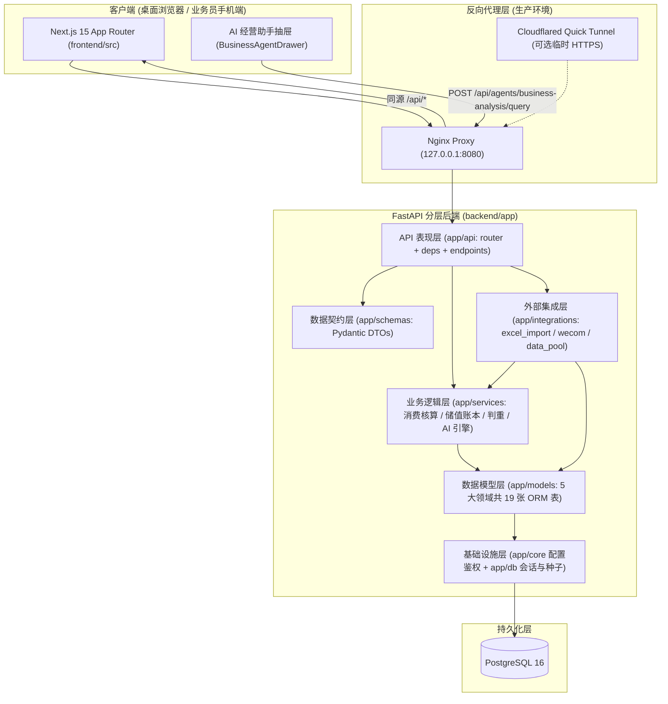
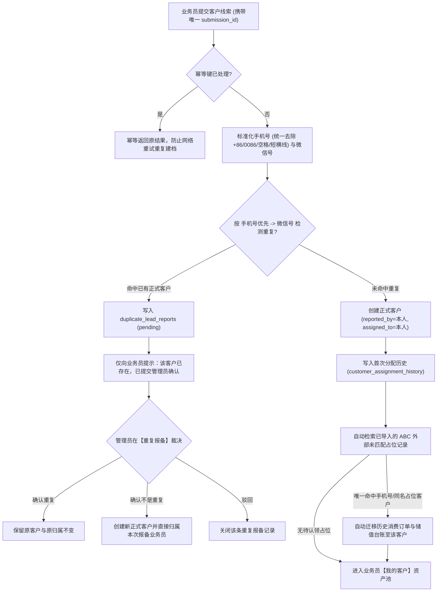
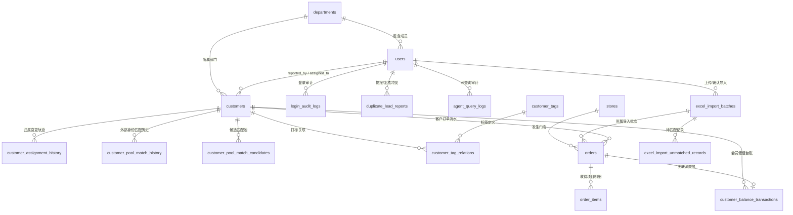

# 观云春 · 企业客户资产经营平台 V1

面向**医疗 / 中医 / 大健康门诊及连锁门店机构**打造的前后端分离企业客户资产经营平台（`customer-assets`）：前端基于 **Next.js 15 + React 19 + TypeScript + Tailwind CSS**，后端采用生产级分层 **FastAPI + SQLAlchemy 2.0 + Pydantic v2**，底层持久化采用 **PostgreSQL 16 + Alembic**。

当前唯一外部数据入口为管理员上传 **ABC 诊所平台导出的收费明细 Excel**，系统不依赖外部数据库直连或爬虫，兼顾数据安全性、审计可追溯性与部署极简性。

---

## 目录

1. [项目定位与解决的核心问题](#1-项目定位与解决的核心问题)
2. [技术架构与生产级工程目录](#2-技术架构与生产级工程目录)
3. [分角色权限与核心业务流程](#3-分角色权限与核心业务流程)
4. [数据库表全景字典（19 张表）](#4-数据库表全景字典19-张表)
5. [快速启动与 Demo 账号](#5-快速启动与-demo-账号)
6. [核心 API 路由清单](#6-核心-api-路由清单)
7. [运维、迁移与部署文档](#7-运维迁移与部署文档)

---

## 1. 项目定位与解决的核心问题

在门诊及大健康机构日常经营中，前端市场拓客团队（地推、线上私域、义诊活动、转介绍）与诊所内部的医疗收费系统（ABC 平台）往往相互独立。本平台旨在打通“**线索报备确权 → 线下诊疗收费导入 → 客户资产归集 → 经营决策分析**”全链路闭环：

1. **拓客报备与资产确权分离**：业务员通过移动端/桌面端随时报备线索，自动归一化手机号与微信号判重、支持 `submission_id` 幂等防重；系统严格分离**首次报备人（`reported_by`，永久不变）**与**当前负责业务员（`assigned_to`，支持主管调配并全程记录变更轨迹）**。
2. **ABC 平台离线 Excel 安全打通**：支持 `.xlsx` / `.xls` 多工作表（流水、分类、明细）“先预览、后确认”两阶段导入，按患者档案号优先、标准化手机号次之进行双向匹配（含“先导入未匹配占位、业务员后补报备自动认领”与“管理员人工绑定/忽略”）。
3. **医疗级四维财务与会员储值核算**：严格解耦**消费价值（项目/明细原值）**、**实收金额**、**有效经营收入（医保 + 自费，含全额抵扣项目规则）**与**会员储值台账（充值 / 退费 / 储值扣减）**，不做模糊比例估算，异常拆分与余额不足自动写入对账审计日志。
4. **行级权限隔离与只读 AI 经营助手**：业务员仅可访问本人当前负责的客户与消费；管理员拥有全局看板、周报/月报快照、二维客户来源归档分析及内置**只读 AI 经营助手**（自然语言转受控类型化 `QueryPlan`，零裸 SQL 注入与误写风险）。

---

## 2. 技术架构与生产级工程目录

### 2.1 系统拓扑架构图



### 2.2 仓库目录结构（生产级前后端分离规范）

```text
customer-assets/
├── README.md                           # 项目全景说明文档
├── .env.example                        # 环境变量配置模板
├── docker-compose.yml                  # 本地开发容器编排
├── docker-compose.production.yml       # 生产环境容器编排 (内网隔离 + 回环 Nginx)
│
├── docs/                               # 【文档与设计资产中心】
│   ├── deployment.md                   # 阿里云 ECS 生产部署、备份与 HTTPS 指南
│   ├── field-specs.md                  # 系统字段清单与 ABC 收费明细映射图册
│   ├── assets/                         # 字段清单与收费明细 SVG / PNG 设计图资源
│   └── hosted-demo/                    # 纯静态前端交互演示原型包
│
├── deploy/                             # 【生产部署配置】Nginx 配置、ECS 镜像覆盖与初始化脚本
├── scripts/                            # 【宿主机脚本】本地 Quick Tunnel 快捷启动脚本
│
├── backend/                            # 【FastAPI 生产级分层后端】
│   ├── Dockerfile
│   ├── alembic.ini
│   ├── requirements.txt
│   ├── alembic/                        # 数据库迁移脚本 (versions/001 ~ 022)
│   ├── scripts/                        # 容器内运维脚本 (清理测试导入 / 重置业务数据)
│   ├── tests/                          # 后端单元与集成测试套件
│   └── app/
│       ├── main.py                     # FastAPI 应用入口、生命周期钩子与路由挂载
│       ├── core/                       # 核心层：全局 Settings 配置、JWT/PBKDF2 安全鉴权、时区工具
│       ├── db/                         # 数据库层：DeclarativeBase、Session 会话管理、基础种子初始化
│       ├── models/                     # 模型层 (ORM)：按 org / customer / order / integration / analytics 拆分
│       ├── schemas/                    # 契约层 (Pydantic)：按 auth / lead / customer / order / tag / report / agent 拆分
│       ├── api/                        # 表现层 (API)：deps 权限依赖注入、router 聚合路由、endpoints 各业务控制器
│       ├── services/                   # 服务层：消费与营收计算、会员储值台账、线索判重、RBAC 作用域、AI 经营助手
│       └── integrations/               # 集成适配层：ABC Excel 解析与匹配 (excel_import)、企微预留 (wecom)、兼容数据池
│
└── frontend/                           # 【Next.js 15 标准前端工程】
    ├── Dockerfile
    ├── next.config.mjs                 # Standalone 输出与 /api 反向代理重写
    ├── tailwind.config.ts
    ├── tsconfig.json                   # 开启严格模式与 @/* 路径别名
    ├── public/                         # 静态公共资源
    └── src/
        ├── app/                        # App Router 页面路由 (dashboard / leads / customers / orders / reports 等)
        ├── components/                 # 响应式导航骨架 (app-shell)、通用 UI、SVG 图表与 AI 助手抽屉
        ├── lib/                        # API 请求封装、北京时间格式化、客户来源分类工具
        └── types/                      # 全局前后端对齐 TypeScript 类型定义
```

---

## 3. 分角色权限与核心业务流程

### 3.1 角色权限对照

| 角色 | 账号示例 | 核心权限范围 |
| :--- | :--- | :--- |
| **管理员 / 主管 (`admin`)** | `admin01`, `admin02` | 查看全量客户、外部档案号、消费订单与经营看板；创建含二级来源归档的客户；处理重复报备冲突；调整单个/批量客户归属；作废错误客户；上传确认 ABC Excel 并处理待匹配队列；维护标签与账号状态；查看周/月报与使用只读 AI 经营助手。 |
| **业务员 (`salesperson`)** | `sales01` ~ `sales03` | 仅可查看 `customers.assigned_to = 当前登录用户` 的名下客户与消费明细（后端强制行级作用域过滤，修改 URL/ID 无法越权）；提交基础客户线索并即时自动归属本人；查看个人业绩看板；在“我的”页面修改个人显示姓名。 |

### 3.2 线索报备、自动认领与重复报备裁决流程



### 3.3 ABC Excel 两阶段导入与财务核算规则

```text
ABC 平台导出 Excel (.xlsx/.xls) → 管理员上传预览 (解析流水/分类/明细 Sheet) → 管理员确认导入 → 幂等去重 & 双向匹配 → PostgreSQL
```

1. **客户匹配优先级**：优先匹配 `external_customer_id`（患者档案号/患者 ID），其次匹配标准化手机号；**姓名绝不单独作为正式客户自动匹配条件**。未命中或手机号命中多名客户的交易进入 `excel_import_unmatched_records` 待匹配队列，由管理员人工绑定或忽略，绝不随机分配业务员。
2. **交易幂等去重**：优先使用收费单号/结算单号/交易流水号（`external_transaction_id`）；缺失稳定单号时，基于患者身份、就诊号、收费时间、支付方式与实收金额计算 `transaction_fingerprint` SHA 指纹。重复上传相同文件只会更新或跳过，绝不重复生成订单。
3. **保护人工资产字段**：Excel 导入仅更新客户外部消费快照、订单明细与储值台账，绝不覆盖 `reported_by`、`assigned_to`、来源归档分类（`source_level_1` / `source_level_2`）、客户标签、客户状态或备注。
4. **四维金额与储值口径**：
   - **消费价值 (`consumption_value`)**：优先汇总 `order_items.amount` 明细金额（退费取负），按就诊号 `visit_no` 正负冲抵后净额 `> 0` 计 1 次有效到店消费。
   - **实收金额 (`actual_paid_amount`)**：实际支付净额。
   - **有效经营收入 (`effective_revenue`)**：验证通过时取 `医保支付 + 自费支付`；全额抵扣（无医保、实收为 0、有抵扣额）的真实治疗项目，按业务规则将其项目消费价值计入自费与有效经营收入一次。拆分不一致时保留原始数据并记录 `payment_amount_mismatch`。
   - **会员储值台账 (`customer_balance_transactions`)**：充值与退卡流水（`transaction_kind = "balance_transaction"`）独立记入客户储值账本，不计入消费价值与经营收入；当储值扣减会导致余额为负时，保留原始订单并写入 `balance_insufficient` 异常日志。

---

## 4. 数据库表全景字典（19 张表）

全部 ORM 模型位于 [`backend/app/models/`](backend/app/models/)，按五大业务子域划分：

### 4.1 实体关系图 (ER Diagram)



### 4.2 数据表清单

| 领域模块 | 数据表名 | ORM 模型类 | 核心职责与关键字段 |
| :--- | :--- | :--- | :--- |
| **组织与安全**<br>(`models/org.py`) | `departments` | `Department` | 业务部门字典（`name` 唯一、`description`） |
| | `users` | `User` | 系统用户（`username`、`full_name`、`password_hash`、`role`、`is_active`） |
| | `login_audit_logs` | `LoginAuditLog` | 登录安全审计（记录每次登录成败与原因，绝不留存密码材料） |
| | `stores` | `Store` | 线下门店字典（`name`、`address`） |
| **客户与线索**<br>(`models/customer.py`) | `customers` | `Customer` | 核心客户资产主表（`external_customer_id`、`submission_id`、二级来源 `source_level_1/2`、`reported_by`、`assigned_to`、储值派生余额、软删除作废字段） |
| | `duplicate_lead_reports` | `DuplicateLeadReport` | 业务员重复报备冲突记录与管理员裁决状态 |
| | `customer_assignment_history` | `CustomerAssignmentHistory` | 客户归属人历次分配与调配不可变审计轨迹 |
| | `customer_tags` | `CustomerTag` | 客户标签字典（`name`、`color`） |
| | `customer_tag_relations` | `CustomerTagRelation` | 客户与标签多对多关联表（联合唯一约束） |
| | `customer_pool_match_history` | `CustomerPoolMatchHistory` | 外部患者档案号匹配、人工绑定与客户作废释放历史 |
| | `customer_pool_match_candidates` | `CustomerPoolMatchCandidate` | 历史外部数据池候选匹配表（兼容保留） |
| **交易与储值**<br>(`models/order.py`) | `orders` | `Order` | 诊疗收费、退费与储值原始交易主表（含外部流水号、交易指纹、原价/应收/实收/抵扣/优惠/医保/自费、`transaction_kind`、`is_refund`） |
| | `order_items` | `OrderItem` | 订单收费项目明细表（三级项目分类、编码、单价、数量、`amount`） |
| | `customer_balance_transactions` | `CustomerBalanceTransaction` | 客户级会员储值不可变流水台账（`recharge`/`refund`/`consume`/`adjustment`、`balance_before`/`after`） |
| **数据集成**<br>(`models/integration.py`) | `excel_import_batches` | `ExcelImportBatch` | ABC Excel 上传批次、OSS 原件归档元数据（`oss_bucket`、`oss_object_key`、`file_sha256`、`file_size_bytes`）、预览快照与导入统计计数 |
| | `excel_import_unmatched_records` | `ExcelImportUnmatchedRecord` | 待匹配或冲突的外部交易队列（支持人工绑定或忽略） |
| | `integration_logs` | `IntegrationLog` | 导入异常、医保自费拆分不一致与储值余额不足对账日志 |
| **经营与 AI**<br>(`models/analytics.py`) | `reports` | `Report` | 周报/月报统计指标 JSON 快照与自动经营摘要 |
| | `agent_query_logs` | `AgentQueryLog` | 只读 AI 经营助手自然语言提问、结构化 `QueryPlan` 与耗时审计 |

> 详细字段映射图示请参阅 [`docs/field-specs.md`](docs/field-specs.md)。

---

## 5. 快速启动与 Demo 账号

### 5.1 本地一键启动

```bash
cp .env.example .env
docker compose up --build
```

启动完成后访问：
- **前端工作台**：`http://localhost:3000`（局域网同事可访问 `http://<宿主机局域网IP>:3000`，前端通过同源 `/api` 代理转发，不会误请求访客本机 `localhost`）
- **Swagger API 文档**：`http://localhost:8000/docs`
- **健康检查**：`http://localhost:8000/health`

首次启动会自动执行 Alembic 数据库迁移，并初始化 5 个基础账号、5 个业务部门与 8 个默认客户标签；**不会自动生成任何虚拟客户、订单或导入记录**，可直接上传真实 ABC Excel 使用。

### 5.2 初始系统账号

| 登录账号 | 默认密码 | 角色 | 默认姓名 |
| :--- | :--- | :--- | :--- |
| `admin01` | `Admin01@123` | 管理员 / 主管 | 林总 |
| `admin02` | `Admin02@123` | 管理员 / 主管 | 陈主管 |
| `sales01` | `Sales01@123` | 业务员 | 王明 |
| `sales02` | `Sales02@123` | 业务员 | 苏晴 |
| `sales03` | `Sales03@123` | 业务员 | 叶宁 |

---

## 6. 核心 API 路由清单

所有业务接口均挂载于 `/api` 前缀下（路由聚合见 [`backend/app/api/router.py`](backend/app/api/router.py)）：

- **认证与个人资料**：`POST /api/auth/login`、`GET /api/auth/me`、`PATCH /api/auth/me/profile`（业务员修改显示姓名）
- **经营看板与报告**：`GET /api/dashboard`、`GET /api/reports`（管理员周报/月报）
- **线索报备与判重**：`GET / POST /api/leads`、`GET /api/leads/mine`、`GET /api/duplicate-reports`、`POST /api/duplicate-reports/{report_id}/review`
- **客户资产管理**：`GET /api/customers`、`GET /api/customers/meta`、`GET /api/customers/owner-summary`、`GET /api/customers/{customer_id}`、`POST /api/customers/{customer_id}/reassign`、`PATCH /api/customers/{customer_id}/assignment`、`POST /api/customers/bulk-assignment`、`POST /api/customers/{customer_id}/void`（客户作废）、`GET /api/customers/assignment-history`
- **客户标签与账号**：`PUT /api/customers/{customer_id}/tags`、`GET / POST / PATCH / DELETE /api/tags`、`GET /api/users`、`PATCH /api/users/{user_id}/status`
- **消费与订单导出**：`GET /api/orders`、`GET /api/orders/customer-summary`、`GET /api/orders/export`（CSV 导出）
- **ABC Excel 导入与原表归档**：`POST /api/excel-imports/abc/preview`（上传即归档至阿里云 OSS）、`POST /api/excel-imports/abc/{batch_id}/confirm`、`GET /api/excel-imports/abc/history`、`GET /api/excel-imports/abc/{batch_id}/download`（获取原文件签名下载链接）、`GET /api/excel-imports/abc/unmatched`、`POST /api/excel-imports/abc/unmatched/{record_id}/bind`、`POST /api/excel-imports/abc/unmatched/{record_id}/ignore`
- **只读 AI 经营助手**：`POST /api/agents/business-analysis/query`（管理员）

---

## 7. 运维、迁移与部署文档

- **数据库迁移**：后端容器启动时自动执行升级；也可手动运行：
  ```bash
  docker compose exec backend alembic upgrade head
  ```
- **运行单元测试**：
  ```bash
  docker compose exec backend python -m unittest discover -s tests -v
  ```
- **清理 ABC 测试导入数据**（仅容器内命令行执行，默认只预览，确认备份后加 `--apply` 提交）：
  ```bash
  docker compose exec backend python scripts/cleanup_abc_test_data.py
  docker compose exec backend python scripts/cleanup_abc_test_data.py --apply
  ```
- **重置全部客户业务档案**（清空客户、订单、导入记录、报告与 AI 日志，保留账号、部门与标签字典，默认只预览）：
  ```bash
  docker compose exec backend python scripts/reset_customer_business_data.py
  docker compose exec backend python scripts/reset_customer_business_data.py --apply
  ```
- **更多专项文档**：
  - 阿里云 ECS 生产环境部署、安全组隔离、PostgreSQL 备份与临时 HTTPS 隧道：[`docs/deployment.md`](docs/deployment.md)
  - 系统字段清单与 ABC 真实收费明细字段映射图册：[`docs/field-specs.md`](docs/field-specs.md)
