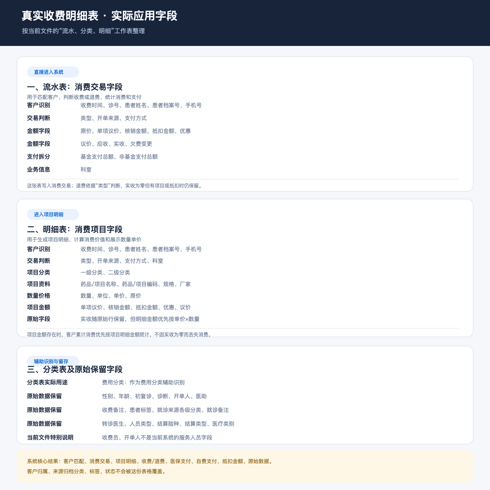

# 系统字段清单与 ABC 收费明细映射图册

本文档归档了本平台数据库字段设计及外部 **ABC 诊所平台导出收费明细** 在系统内的实际映射与取值规范。

## 1. 系统全局字段清单

- 矢量原图：[`assets/系统字段清单-中文.svg`](assets/系统字段清单-中文.svg)
- 预览位图：

## 2. 分页字段清单说明

### 第 1 页
- 矢量原图：[`assets/字段清单-中文-第1页.svg`](assets/字段清单-中文-第1页.svg)

### 第 2 页
- 矢量原图：[`assets/字段清单-中文-第2页.svg`](assets/字段清单-中文-第2页.svg)

### 第 3 页
- 矢量原图：[`assets/字段清单-中文-第3页.svg`](assets/字段清单-中文-第3页.svg)

## 3. ABC 真实收费明细实际应用字段

- 矢量原图：[`assets/真实收费明细-实际应用字段-中文.svg`](assets/真实收费明细-实际应用字段-中文.svg)

